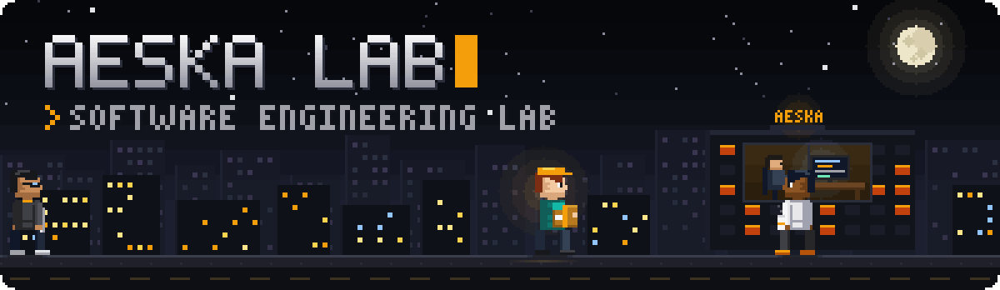

<p align="center">
  
</p>

<p align="center">
  <a href="https://aeskalab.com"></a>
  <a href="mailto:hello@aeskalab.com"></a>
  
  
</p>

### Software built to run your business, not just to demo

**AESKA LAB SOLUTION** is a software development company in Johor Bahru, Malaysia. We design, build and maintain custom software, web and mobile apps, cloud systems and AI integrations for startups, SMEs and enterprises across Malaysia.

You get one team from the first conversation to production, and we stay after launch to keep it running.

**[Start a project →](https://aeskalab.com/contact)** &nbsp;·&nbsp; or email [hello@aeskalab.com](mailto:hello@aeskalab.com)

### What we build

| | |
|---|---|
| **Custom software** <br><sub>Reliable software, from architecture to production. Built to grow with you.</sub> | **Web platforms** <br><sub>Fast, modern websites and web apps with clean code and a sharp user experience.</sub> |
| **Mobile and desktop apps** <br><sub>Apps that feel native on every device.</sub> | **Cloud and APIs** <br><sub>Cloud apps and clean APIs that scale on demand and hold up under load.</sub> |
| **Integration and automation** <br><sub>Connect your tools. Remove the manual work.</sub> | **AI and machine learning** <br><sub>Practical AI that adds real value. No hype.</sub> |
| **Data and dashboards** <br><sub>Turn data into decisions with dashboards built around your KPIs.</sub> | **Business systems** <br><sub>ERP, CRM and internal tools that streamline every department.</sub> |

### Our own products

We build products of our own, so we know what it takes to run software in production, not just to hand it over.

<table>
  <tr>
    <td width="50%" valign="top">
      <h4><a href="https://film.aeskalab.com">AeskaFilm</a></h4>
      A disposable camera on every table. Guests scan a card and shoot a roll on their phone. No app to install, and everyone gets every photo in a private event book.
      <br><br>
      <sub>Live at <a href="https://film.aeskalab.com">film.aeskalab.com</a></sub>
    </td>
    <td width="50%" valign="top">
      <h4>WEDD</h4>
      Wedding planning, all in one place. Find verified wedding vendors, compare prices, pay safely and plan everything in one app.
      <br><br>
      <sub>In development · Android app, vendor web portal and website</sub>
    </td>
  </tr>
</table>

### How we work

```text
Discovery → Planning → UI/UX design → Development → Testing → Deployment → Maintenance
```

- **We define the problem before we write a line of code.** Scope, architecture and a clear roadmap, so everyone knows what is being built and why.
- **You see progress as it happens.** Clean, tested increments, with interfaces validated before we build them.
- **Releases without surprises.** Automated and manual checks, then modern CI/CD to ship.
- **We stay for the long run.** We monitor, support and evolve your product after launch.

### Our stack

<p>
  <br>
  <br>
  
</p>

---

<p align="center">
  <b>Have a project in mind?</b> Tell us the problem; we'll reply with how we'd solve it.<br>
  <a href="https://aeskalab.com/contact"><b>Start a project</b></a> &nbsp;·&nbsp;
  <a href="https://www.linkedin.com/company/aeskalab">LinkedIn</a> &nbsp;·&nbsp;
  <a href="https://www.threads.com/@aeska.lab">Threads</a> &nbsp;·&nbsp;
  <a href="https://aeskalab.com">aeskalab.com</a>
  <br><sub>AESKA LAB SOLUTION · SSM 202603160530 (KT0616122-U) · Johor Bahru, Malaysia</sub>
</p>
